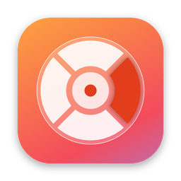

  

<h1 align="center">RuedaConvert</h1>

  Convierte archivos en tu Mac con un gesto: arrastra un archivo, pulsa <b>Shift</b> y suéltalo en el formato que quieras.

  <a href="../../releases/latest/download/RuedaConvert-macOS.zip"><b>⬇︎ Descargar para Mac</b></a>
  · macOS 13 o más nuevo · Apple Silicon e Intel · Gratis

---

## Instalar

1. [Descarga `RuedaConvert-macOS.zip`](../../releases/latest/download/RuedaConvert-macOS.zip) y ábrelo.
2. Arrastra **RuedaConvert** a tu carpeta **Aplicaciones**.
3. Ábrela. Si macOS dice que no puede comprobar la app, ve a **Ajustes del Sistema → Privacidad y seguridad**, baja hasta *Seguridad* y pulsa **Abrir igualmente**. Solo se hace una vez.

Aparecerá una ventana de bienvenida y el icono de RuedaConvert en la barra de menú.

## Cómo se usa

1. Empieza a arrastrar un archivo desde Finder o el Escritorio.
2. Sin soltarlo, pulsa **Shift**: aparece la rueda bajo el cursor.
3. Suelta el archivo sobre el formato que quieras. El centro (✕) cancela.

Lo convertido se guarda en **Descargas**. Para guardarlo junto al original: icono de la barra de menú → **Ajustes… → Dar permiso a una carpeta**. Nunca se sobrescribe nada.

## Qué convierte

| Arrastras | Obtienes |
|---|---|
| PDF | Word (DOCX), JPG, PNG, texto |
| Fotos: HEIC, JPG, PNG, WEBP, GIF, TIFF, BMP | JPG, PNG, HEIC, PDF, texto (OCR) |
| Documentos: DOCX, DOC, RTF, ODT, HTML, TXT, Markdown | PDF, DOCX, TXT, RTF, HTML |

## Privacidad

Todo se convierte en tu Mac con las herramientas del sistema (PDFKit, ImageIO, Vision). La app no se conecta a internet ni recopila datos. [Política de privacidad](docs/privacidad.html).

---

## Para desarrolladores

### Compilar

1. Instala **Xcode** desde la Mac App Store.
2. Abre `RuedaConvert.xcodeproj`.
3. Target **RuedaConvert → Signing & Capabilities → Team**: elige tu Apple ID.
4. Pulsa **⌘R**.

### Estructura

- `Sources/App.swift` — detecta "arrastrar + Shift" y el menú de la barra.
- `Sources/Wheel.swift` — la rueda flotante y el soltar sobre ella.
- `Sources/Converter.swift` — todas las conversiones.
- `Sources/SaveLocations.swift` — permisos de carpetas (sandbox).
- `Sources/SettingsWindow.swift` — ventana de bienvenida y ajustes.
- `Sources/Toast.swift` — avisos de "Convirtiendo…" / "Listo".
- `Support/` — Info.plist y entitlements del sandbox.
- `Resources/` — iconos y manifiesto de privacidad.
- `docs/` — página web (GitHub Pages): descarga, soporte y privacidad.
- `.github/workflows/release.yml` — compila la app y la adjunta a cada versión publicada.
- `project.yml` — definición del proyecto para [XcodeGen](https://github.com/yonaskolb/XcodeGen) (el `.xcodeproj` ya viene generado).

Para añadir un formato: agrégalo a `OutputFormat` y a `targets(for:)` en `Converter.swift`, y escribe su conversión.

### Publicar

Ver [PUBLICAR.md](PUBLICAR.md): versiones descargables en GitHub y Mac App Store.

## Licencia

[MIT](LICENSE) © 2026 Heber Gomez
